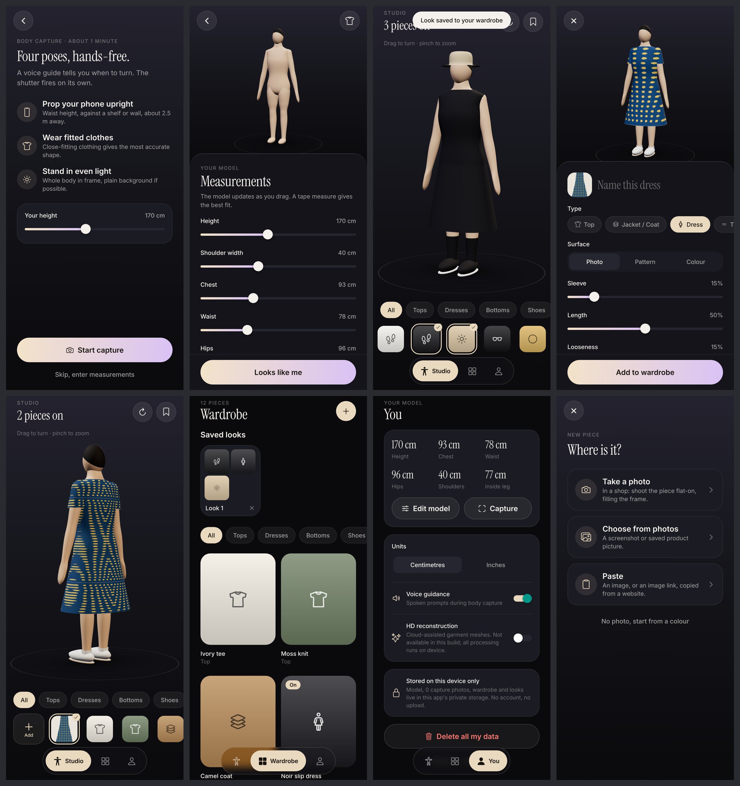

# Stylista

3D virtual try-on for iOS and Android. A user builds a parametric 3D model of their body,
then adds clothes from a camera photo, the photo library, or the clipboard and views them
on the model from any angle. All data stays on the device.



## Stack

- Expo SDK 58 / React Native 0.88, TypeScript, Expo Router
- three.js through `@react-three/fiber` (expo-gl on device, WebGL on web)
- Reanimated for UI motion, zustand + AsyncStorage for state, expo-file-system for images

## Run

```bash
npm install
npx expo start            # dev server; press i / a, or w for the web preview
npx tsc --noEmit          # typecheck
npx expo lint             # lint
```

Camera, clipboard images, haptics and speech need a development build or Expo Go on a
real device. Store builds: `eas build -p ios` / `eas build -p android`.

## Layout

| Path | Contents |
| --- | --- |
| `src/app` | Routes: onboarding, capture, body editor, home, garment editor |
| `src/screens` | Studio, Wardrobe, Profile, GarmentEditor |
| `src/three` | `loft.ts` surface skinning, `body.ts` parametric body, `garments.ts` garment templates, `Stage.tsx` viewer |
| `src/ml` | Inference stage interfaces and their on-device implementations |
| `src/lib` | Catalog, image persistence and garment texture extraction, units |
| `src/store` | Persisted app state |

## How it works

**Body.** Six measurements define elliptical cross-sections (circumference to half-axes via
Ramanujan's approximation) at anatomical heights. Monotone cubic interpolation between
them gives the torso, limbs and head, skinned into meshes. A rebuild costs a few thousand
vertices, so the model follows sliders in real time.

**Garments.** Each garment type is a template defined as an offset surface over the same
body functions, so it refits automatically when measurements change. Sleeve, length,
looseness and flare are continuous parameters.

**Photo to texture.** `extractGarmentTexture` estimates the backdrop colour from the image
border, keys it out, and stretches each row of the garment silhouette to the full texture
width. The result contains fabric only and is projected onto the template front and back.
Cluttered backdrops fall back to the raw photo and a dominant colour.

## Milestone status

Done: app shell, design system, onboarding, hands-free 4-pose capture flow (voice,
countdown, upright check), measurement editor, 3D studio (orbit, pinch zoom, inertia,
per-category framing), wardrobe, saved looks, garment import and editor, local storage,
data wipe.

Not yet implemented:

- Body shape estimation from the captured frames. `bodyEstimator` currently scales average
  proportions to the entered height; the user fine-tunes with sliders. Frames are stored
  locally for a silhouette-based regressor behind the same interface.
- Learned garment segmentation and type classification (current keying is classical and
  needs a fairly uniform backdrop; type is chosen by the user).
- Cloud "HD reconstruction" (opt-in). Interface and setting exist; no endpoint configured.
- Face/skin texture on the avatar, cloth simulation.
- App icon and splash artwork are still the Expo defaults; bundle id `com.stylista.app`
  is a placeholder.
